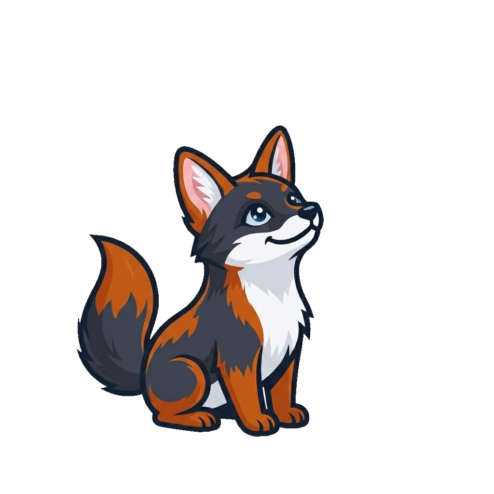
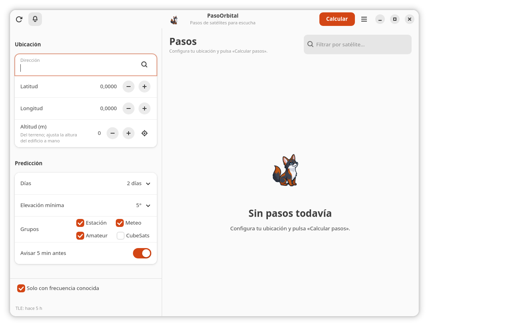

# PasoOrbital · pasos de satélites para escucha

[](https://github.com/asterion/pasoorbital/actions/workflows/tests.yml)
[](LICENSE)
[](https://www.python.org/)

**PasoOrbital está formado por dos aplicaciones independientes sobre un mismo motor:**

- **PasoOrbital Desktop**: app nativa para GNOME (GTK4 + libadwaita), pensada para
  el uso diario; se instala como `.deb` o `.rpm`.
- **PasoOrbital Web**: app web que corre **solo en tu computador**, en
  `127.0.0.1`; se abre en el navegador y no necesita instalar una app nativa.

Las dos comparten el mismo cálculo orbital, catálogo, frecuencias, Doppler y CLI.
**No dependen una de la otra** y puedes tener ambas instaladas o ejecutándose a la vez.

**English:** PasoOrbital predicts satellite passes for radio listening. It ships
two independent frontends — a GTK4 desktop app and a local web app — on top of
the same SGP4 engine. Free software under the MIT license.

[Ir a la app de escritorio](#app-de-escritorio-gnome) ·
[Ir a la web local](#web-local) ·
[Qué comparten](#qué-comparten)

## Dos aplicaciones, un mismo motor

| | **PasoOrbital Desktop** | **PasoOrbital Web** |
| --- | --- | --- |
| Interfaz | Nativa GTK4 + libadwaita | Navegador |
| Sistema | Linux con GTK4/libadwaita | Windows, macOS o Linux con Python |
| Se instala | `.deb` o `.rpm` | Python + `./run.sh` |
| Dónde corre | En el escritorio, sin navegador | Servidor local en `127.0.0.1` |
| Servidor | No | Sí, local |
| Internet | Solo para TLE y geocodificación | Solo para TLE y geocodificación |
| Notificaciones de escritorio | **Sí** | No |
| Cielo en vivo | **Sí** | No |
| Astro en la interfaz | **Sí** | No |
| Ideal para | Uso diario desde el menú | Probar o usar desde otro equipo sin app nativa |

La **web no es un servicio en la nube**: no hay servidor público, cuentas ni
telemetría. Se levanta en tu equipo y se usa desde el navegador.

## App de escritorio (GNOME)


La app nativa es la opción recomendada para escuchar satélites todos los días.
Además de la predicción, agrega:

- **Próximo paso** destacado, con cuenta atrás y acceso directo al detalle.
- **Aviso de escritorio 5 minutos antes** y resaltado de la fila próxima o en curso.
- **Detalle modal** con pestañas Resumen, Radio y Cielo.
- **Cielo en vivo**: marcador del satélite, estela recorrida, línea «ahora» y
  progreso del paso.
- **Astro**, la mascota, en la cabecera y en el estado vacío.
- Comandos LRPT ajustados a **SatDump 1.2.2**.
- Paquetes **`.deb`** y **`.rpm`**.


[Ver el detalle modal con pestañas](docs/desktop-detalle.png).

### Instalar PasoOrbital Desktop

Descarga el paquete desde la última release:

- [Última release](https://github.com/asterion/pasoorbital/releases/latest)
- [`.deb` para Debian/Ubuntu](https://github.com/asterion/pasoorbital/releases/download/v1.9.0/pasoorbital_1.9.0-1_all.deb)
- [`.rpm` para Fedora 41/42](https://github.com/asterion/pasoorbital/releases/download/v1.9.0/pasoorbital-1.9.0-1.noarch.rpm)

```bash
# Debian / Ubuntu
sudo apt install ./pasoorbital_1.9.0-1_all.deb
pasoorbital-gui

# Fedora
sudo rpm -ivh pasoorbital-1.9.0-1.noarch.rpm
pasoorbital-gui
```

El RPM se instala con `rpm`, sin repositorio ni `dnf`. Si faltan dependencias de
Fedora, `rpm` las mostrará antes de instalar.

<details>
<summary>Aviso al instalar un <code>.deb</code> local</summary>

Si aparece «La descarga se realiza sin aislamiento como root…», es porque el
archivo está dentro de una carpeta privada (por ejemplo, `/home/tu-usuario` con
permisos 750) y el usuario `_apt` no puede leerlo. No es un error. Para evitarlo:

```bash
cp pasoorbital_1.9.0-1_all.deb /tmp/
sudo apt install /tmp/pasoorbital_1.9.0-1_all.deb
```
</details>

Dependencias del escritorio: `python3-gi`, `gir1.2-gtk-4.0`,
`gir1.2-gdkpixbuf-2.0`, `gir1.2-adw-1` (1.6 o superior), `python3-numpy` y
`python3-sgp4`. En Ubuntu, `python3-sgp4` está en `universe`.

La configuración se guarda en `~/.config/pasoorbital/` y los TLE y la caché en
`~/.cache/pasoorbital/`.

### Construir PasoOrbital Desktop desde el código

```bash
cd desktop
./build_deb.sh     # Debian/Ubuntu
./build_rpm.sh     # Fedora; requiere rpmbuild
```

Los paquetes quedan en `desktop/dist/`. Más detalles en
[desktop/README.md](desktop/README.md).

## Web local


La web es una aplicación local para el navegador. No hay una versión alojada:
la ejecutas en tu computador y abres `http://127.0.0.1:8765`.

Incluye predicción de pasos, tabla ordenada, búsqueda, frecuencias, Doppler,
gráficos, calendario `.ics`, API local y la guía de lectura. La app de escritorio
es la que agrega notificaciones, detalle modal, cielo en vivo y Astro.

### Ejecutar PasoOrbital Web

Requisitos: Python 3.10 o superior y conexión a internet la primera vez.

```bash
cd pasoorbital
./run.sh
```

`run.sh` crea `.venv`, instala las dependencias y abre
<http://127.0.0.1:8765>.

Instalación manual:

```bash
python3 -m venv .venv
.venv/bin/pip install -r requirements.txt
.venv/bin/python app.py
```

Opciones del servidor:

```bash
python app.py --port 9000          # otro puerto
python app.py --host 0.0.0.0       # accesible desde la red local (¡ojo!)
python app.py --refresh            # fuerza la descarga de TLE al arrancar
python app.py --no-browser         # no abrir el navegador
```

La web escucha solo en `127.0.0.1` por defecto. Si usas `--host 0.0.0.0`, queda
expuesta a tu red local; no la publiques en internet sin proxy, TLS y control de
acceso. La API está documentada más abajo.

## Qué comparten

- **Predicción de pasos** para 1, 2, 3 o 7 días, con elevación mínima configurable.
- **Catálogo** de estaciones espaciales, meteorológicos, radioaficionados y
  CubeSats, desde CelesTrak y con caché de 6 horas.
- **Frecuencias de escucha** y **Doppler** en AOS, TCA y LOS.
- **Ubicación** por dirección o coordenadas; la web además usa el GPS del navegador.
- **Altitud del terreno** con Open-Meteo (DEM Copernicus); el edificio se ajusta
  a mano.
- **Calendario `.ics`**, comandos de escucha y **CLI**.
- La misma base de datos y el mismo motor SGP4.

Las direcciones se envían a Nominatim y, al calcular la altitud, las coordenadas
a Open-Meteo. No hay cuentas, telemetría ni servidor propio.

## Mascota

<p align="center"></p>

**Astro** es un zorro de Darwin (*Lycalopex fulvipes*) que mira al cielo en busca
de satélites. Es la mascota oficial de PasoOrbital y aparece en la cabecera y en
el estado vacío de la app de escritorio. La especificación de marca está en
[docs/astro.yaml](docs/astro.yaml); hay versiones en
[512 px](docs/astro-512.png) y [avatar](docs/astro-avatar.png).

<p align="center"></p>

Ilustración final a partir de la referencia visual aportada por Marcos
Matamala Fernandez. La versión vectorial simplificada y editable está en
[astro-vector.svg](docs/astro-vector.svg).

## Uso

### En la app de escritorio

1. Abre **PasoOrbital** desde el menú o ejecuta `pasoorbital-gui`.
2. Escribe una dirección y pulsa **Buscar**, o introduce latitud y longitud.
3. Elige los días, la elevación mínima y los grupos de satélites.
4. Pulsa **Calcular pasos**.
5. Pulsa una fila para abrir el detalle modal.
6. Activa **Avisar 5 min antes** o la campana de la cabecera para recibir el
   aviso del escritorio.

### En la web local

1. Ejecuta `./run.sh` y abre <http://127.0.0.1:8765>.
2. Escribe una dirección y pulsa **Buscar**.
3. Elige los días, la elevación mínima y los grupos.
4. Pulsa **Calcular pasos**.
5. Pulsa una fila para ver el resumen, las frecuencias, el Doppler, la
   trayectoria y los comandos.

La primera vez se abre la guía **«Cómo leer esta tabla»**. El botón **?** de la
barra superior abre el **glosario** con los términos explicados.

La casilla **Solo satélites con frecuencia conocida** oculta los satélites de los
que no hay frecuencia registrada.

### CLI

El CLI es común a las dos aplicaciones:

```bash
python -m pasoorbital.cli --lat -33.45 --lon -70.66 --days 2 --min-el 10
python -m pasoorbital.cli --lat 40.4168 --lon -3.7038 --norad 25544 --json
```

## Cómo leer los datos

| Campo | Significado |
| --- | --- |
| **AOS** | *Acquisition of Signal*: el satélite alcanza la elevación mínima y empieza a oírse. |
| **TCA** | *Time of Closest Approach*: culminación, máxima elevación (mejor momento). |
| **LOS** | *Loss of Signal*: cae por debajo de la elevación mínima. |
| **Elevación** | Altura sobre el horizonte (0° horizonte, 90° cenit). Por debajo de ~10° hay mucho obstáculo y refracción. |
| **Azimut** | Rumbo: 0° norte, 90° este, 180° sur, 270° oeste. |
| **Doppler** | Cambio de frecuencia por la velocidad relativa. Al acercarse, la frecuencia sube; al alejarse, baja. |

El **Doppler** se calcula como `Δf = -v_radial · f / c`. En VHF (145 MHz) llega a
±3,5 kHz; en UHF (435 MHz) a ±10 kHz. En FM estrecha no suele hacer falta
corregirlo; en SSB/CW sí, y en APT/LRPT conviene ajustar el centro del paso.

El gráfico polar muestra el cielo visto desde tu posición: el centro es el cenit,
el borde el horizonte, arriba el norte y a la derecha el este. El punto verde es
el AOS, el ámbar la culminación y el rojo el LOS.

## Escuchar satélites: guía rápida

- **ISS (145.800 MHz FM)**: voz y SSTV en eventos. Repetidor en 437.800 MHz
  (subida 145.990 con tono 67,0 Hz) y APRS en 145.825 MHz.
- **Meteor-M2 3 / M2 4 (137.9 / 137.1 MHz LRPT)**: imagen digital; decodifica con
  [SatDump](https://www.satdump.org/).
- **NOAA 15/18/19 (137.62 / 137.9125 / 137.1 MHz APT)**: imagen analógica; ya no
  están operativos, pero la aplicación conserva sus frecuencias por si usas TLE
  históricos. Alternativa actual: Meteor-M.
- **Radioaficionados FM** (SO-50 436.795, AO-91 145.960, AO-92 145.880, PO-101
  145.900, ISS...): pasos de 5–10 minutos; apunta con azimut/elevación y ajusta el
  Doppler a mano si la señal se va.
- **SSB/CW** (RS-44 435.610, FO-29 435.800, AO-7 145.950...): transpondedores
  lineales; aquí el Doppler importa y se corrige continuamente.

Consejos:

- Usa una antena con ganancia y polarización adecuada (las omnidireccionales
  sirven para FM y APT; para SSB/CW, mejor direccional).
- Empieza a escuchar en TCA y no en AOS: la señal es más fuerte y el Doppler es
  casi nulo.
- En FM, el squelch puede ocultar el inicio del paso: ábrelo o baja el umbral.
- Los comandos que genera la aplicación son un punto de partida: ajusta la
  ganancia (`-g`), el dispositivo y el formato de audio a tu equipo.

## Añadir o corregir frecuencias

Crea `data/frequencies.json` con el número NORAD como clave. Tiene prioridad
sobre la base integrada en `pasoorbital/freqs.py`:

```json
{
  "25544": [
    {"freq_hz": 145800000, "mode": "FM", "label": "Voz", "note": "Uplink 145.200"}
  ]
}
```

Reinicia el servidor para que se recargue. La base integrada es orientativa:
confirma siempre la frecuencia con la web de la misión o de AMSAT/SatNOGS antes
de una escucha importante.

## Precisión y limitaciones

- SGP4 con TLE de CelesTrak: con TLE de menos de 2–3 días el error típico de
  azimut/elevación es inferior a 0,1° (validado contra Skyfield).
- No se modela refracción atmosférica (afecta sobre todo por debajo de 5°).
- La conversión TEME→ECEF usa GMST; el error por precesión/nutación es
  despreciable para apuntar antenas.
- Los **satélites geostacionarios** se excluyen: no tienen pasos, están siempre
  en el mismo punto del cielo.
- Los TLE caducan: si tienen más de ~7 días, la predicción se degrada. El botón ⟳
  fuerza la actualización.
- Las frecuencias y el estado de los satélites cambian; la aplicación no verifica
  si un satélite sigue activo.
- La geocodificación usa Nominatim (máximo ~1 petición/s) y Photon como respaldo.

## API local

| Método | Ruta | Descripción |
| --- | --- | --- |
| GET | `/api/catalog?groups=stations,weather,amateur,cubesat&refresh=1` | Catálogo TLE con frecuencias. |
| GET | `/api/geocode?q=...` | Dirección → latitud/longitud. |
| POST | `/api/passes` | `{lat, lon, alt_m, days, min_el, groups, start}` → pasos. |
| POST | `/api/track` | `{norad, lat, lon, alt_m, aos, los}` → trayectoria aparente. |
| GET | `/api/health` | Estado del servidor. |

Ejemplo:

```bash
curl -s -X POST http://127.0.0.1:8765/api/passes \
  -H 'Content-Type: application/json' \
  -d '{"lat":40.4168,"lon":-3.7038,"days":2,"min_el":10,"groups":["stations"]}'
```

## Estructura

```
pasoorbital/
├── app.py              servidor HTTP y API de la web local
├── pasoorbital/
│   ├── tle.py          descarga/caché de TLE de CelesTrak
│   ├── passes.py       SGP4 + geometría topocéntrica + búsqueda de pasos
│   ├── freqs.py        base de frecuencias de escucha
│   ├── geo.py          geocodificación y altitud (Nominatim/Open-Meteo)
│   └── cli.py          interfaz de terminal
├── static/             interfaz web (HTML, CSS, JS sin dependencias)
├── desktop/            app GTK4/libadwaita, build .deb y .rpm
├── docs/               capturas de pantalla
├── DESARROLLO.md       arquitectura, deuda técnica y hoja de ruta
├── LICENSE             licencia MIT
├── AUTHORS.md          autoría y créditos
├── data/
│   ├── tle/            TLE cacheados por grupo
│   ├── cache/          caché de geocodificación y datos temporales
│   └── frequencies.json  (opcional) frecuencias propias
├── tests/              pruebas unitarias
├── tools/              validación opcional con Skyfield
├── .github/            CI, plantillas de issues y PR
├── pyproject.toml      metadatos y empaquetado Python
├── CONTRIBUTING.md     guía de contribución
├── SECURITY.md         cómo reportar vulnerabilidades
├── CHANGELOG.md        historial de versiones
└── requirements.txt
```

## Autores

- **Marcos Matamala Fernandez** — idea, producto, requisitos, pruebas y mantenimiento.
- **DeepSeek Harness (modelo deepseek-flash)** — implementación, documentación,
  empaquetado y revisión, en colaboración con Marcos.

La titularidad legal del copyright corresponde a Marcos Matamala Fernandez.
Detalles en [AUTHORS.md](AUTHORS.md).

## Créditos

- TLE: [CelesTrak](https://celestrak.org/) (Dr. T. S. Kelso).
- Propagación: [python-sgp4](https://github.com/brandon-rhodes/python-sgp4).
- Direcciones: [OpenStreetMap](https://www.openstreetmap.org/) vía Nominatim y Photon.
- Frecuencias: información pública de AMSAT, IARU y las misiones.
- Altitud del terreno: [Open-Meteo](https://open-meteo.com/) (DEM Copernicus).

Software libre bajo licencia MIT. Respeta las políticas de uso de CelesTrak y Nominatim.

## Repositorio y contribuciones

- Código: <https://github.com/asterion/pasoorbital>
- Incidencias: <https://github.com/asterion/pasoorbital/issues>
- Guía para contribuir: [CONTRIBUTING.md](CONTRIBUTING.md)
- Seguridad: [SECURITY.md](SECURITY.md)
- Historial de cambios: [CHANGELOG.md](CHANGELOG.md)

## Licencia

MIT © 2026 Marcos Matamala Fernandez. Consulta [LICENSE](LICENSE) y [AUTHORS.md](AUTHORS.md).

Documentación técnica y hoja de ruta: [DESARROLLO.md](DESARROLLO.md).
