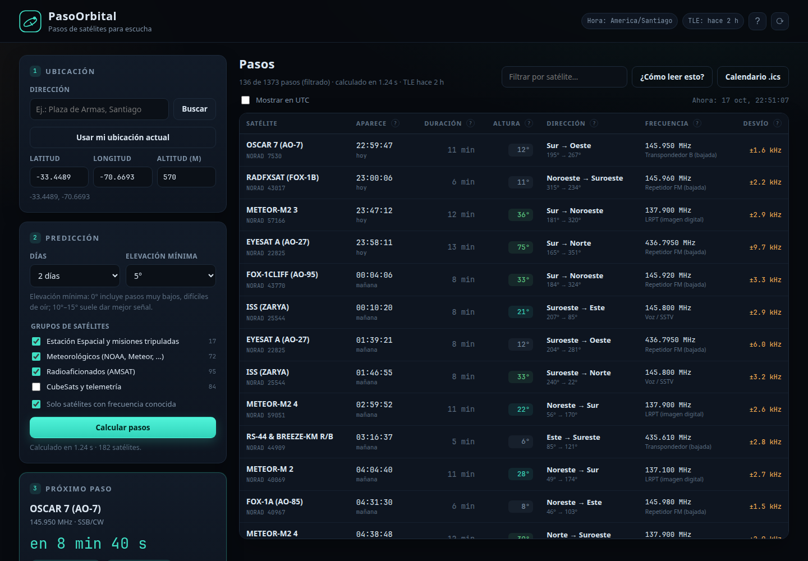

# PasoOrbital · pasos de satélites para escucha

[](https://github.com/asterion/pasoorbital/actions/workflows/tests.yml)
[](LICENSE)
[](https://www.python.org/)

**English:** PasoOrbital predicts satellite passes for radio listening: AOS,
elevation, azimuth, duration, frequency and Doppler, with a local web UI, a
GTK4/libadwaita desktop app and a CLI. Free software under the MIT license.

Herramienta local que calcula **qué satélites pasan por tu ubicación**, con fecha,
hora, elevación, azimut, duración y **desplazamiento Doppler**, pensada para
sintonizar y escuchar satélites con un SDR o un receptor de radio.

No depende de servicios de pago ni de cuentas: usa los TLE públicos de
[CelesTrak](https://celestrak.org/), el modelo orbital SGP4 y la geocodificación
de OpenStreetMap. Funciona en el navegador, en local, y guarda una copia de los
TLE para poder predecir sin conexión.



## Qué incluye

- **Ubicación** por dirección (Nominatim), por coordenadas o con el GPS del navegador.
- **Predicción de pasos** para 1, 2, 3 o 7 días, con elevación mínima configurable.
- **Catálogo** de estaciones espaciales, satélites meteorológicos, radioaficionados
  (AMSAT) y CubeSats, descargado de CelesTrak y cacheado 6 horas.
- **Frecuencias de escucha** por satélite (bajada, subida, tono y modo) y
  **Doppler calculado** en AOS, TCA y LOS.
- **Gráficos** de la trayectoria aparente en el cielo (polar) y de elevación/Doppler
  durante el paso.
- **Comandos de escucha** listos para copiar (`rtl_fm` + `sox`, `noaa-apt`, `SatDump`).
- **Ayuda integrada**: guía «Cómo leer esta tabla», glosario emergente (AOS, TCA, LOS,
  elevación, azimut, Doppler…) y un **resumen en lenguaje llano** de cada paso.
- **Calendario .ics** para llevar los pasos al móvil.
- **CLI** para consultar desde la terminal.

## Instalación

Requisitos: Python 3.10 o superior y conexión a internet la primera vez
(para descargar TLE y dependencias).

```bash
cd satelites
./run.sh
```

`run.sh` crea un entorno virtual en `.venv`, instala `sgp4` y `numpy` y arranca
el servidor en <http://127.0.0.1:8765>.

Instalación manual:

```bash
python3 -m venv .venv
.venv/bin/pip install -r requirements.txt
.venv/bin/python app.py
```

Opciones del servidor:

```bash
python app.py --port 9000          # otro puerto
python app.py --host 0.0.0.0       # accesible desde la red local (¡ojo!)
python app.py --refresh            # fuerza la descarga de TLE al arrancar
python app.py --no-browser         # no abrir el navegador
```

## Versión de escritorio (GNOME)


Además de la web, PasoOrbital tiene una aplicación nativa **GTK4 + libadwaita**, sin
navegador, empaquetada como `.deb`.

```bash
cd desktop
./build_deb.sh
sudo apt install ./dist/pasoorbital_1.2.0-1_all.deb
pasoorbital-gui
```

Depende de `python3-gi`, `gir1.2-gtk-4.0`, `gir1.2-adw-1` (1.6 o superior),
`python3-numpy` y `python3-sgp4` (en Ubuntu, este último está en `universe`).
La configuración se guarda en `~/.config/pasoorbital/` y los TLE y la caché en
`~/.cache/pasoorbital/`.

[Detalle de un paso en la app de escritorio](docs/desktop-detalle.png).

## Uso

1. Escribe una dirección y pulsa **Buscar**, o usa **Usar mi ubicación actual**.
   También puedes introducir latitud y longitud a mano.
2. Elige los días, la elevación mínima y los grupos de satélites.
3. Pulsa **Calcular pasos**. El resultado se ordena por hora de inicio (AOS).
4. Pulsa una fila para ver el detalle: un resumen en lenguaje llano, horario,
   frecuencias, Doppler, trayectoria en el cielo y comandos de escucha.

La primera vez se abre la guía **«Cómo leer esta tabla»**. Después puedes abrirla
con el botón del mismo nombre, y el botón **?** de la barra superior (o cualquier
signo **?** de la tabla) abre el **glosario** con los términos explicados.

La casilla **Solo satélites con frecuencia conocida** oculta los satélites de los
que no hay frecuencia registrada (la mayoría de CubeSats). La configuración se
guarda en el navegador.

### CLI

```bash
python -m pasoorbital.cli --lat -33.45 --lon -70.66 --days 2 --min-el 10
python -m pasoorbital.cli --lat 40.4168 --lon -3.7038 --norad 25544 --json
```

## Cómo leer los datos

| Campo | Significado |
| --- | --- |
| **AOS** | *Acquisition of Signal*: el satélite alcanza la elevación mínima y empieza a oírse. |
| **TCA** | *Time of Closest Approach*: culminación, máxima elevación (mejor momento). |
| **LOS** | *Loss of Signal*: cae por debajo de la elevación mínima. |
| **Elevación** | Altura sobre el horizonte (0° horizonte, 90° cenit). Por debajo de ~10° hay mucho obstáculo y refracción. |
| **Azimut** | Rumbo: 0° norte, 90° este, 180° sur, 270° oeste. |
| **Doppler** | Cambio de frecuencia por la velocidad relativa. Al acercarse, la frecuencia sube; al alejarse, baja. |

El **Doppler** se calcula como `Δf = -v_radial · f / c`. En VHF (145 MHz) llega a
±3,5 kHz; en UHF (435 MHz) a ±10 kHz. En FM estrecha no suele hacer falta
corregirlo; en SSB/CW sí, y en APT/LRPT conviene ajustar el centro del paso.

El gráfico polar muestra el cielo visto desde tu posición: el centro es el cenit,
el borde el horizonte, arriba el norte y a la derecha el este. El punto verde es
el AOS, el ámbar la culminación y el rojo el LOS.

## Escuchar satélites: guía rápida

- **ISS (145.800 MHz FM)**: voz y SSTV en eventos. Repetidor en 437.800 MHz
  (subida 145.990 con tono 67,0 Hz) y APRS en 145.825 MHz.
- **Meteor-M2 3 / M2 4 (137.9 / 137.1 MHz LRPT)**: imagen digital; decodifica con
  [SatDump](https://www.satdump.org/).
- **NOAA 15/18/19 (137.62 / 137.9125 / 137.1 MHz APT)**: imagen analógica; ya no
  están operativos, pero la aplicación conserva sus frecuencias por si usas TLE
  históricos. Alternativa actual: Meteor-M.
- **Radioaficionados FM** (SO-50 436.795, AO-91 145.960, AO-92 145.880, PO-101
  145.900, ISS...): pasos de 5–10 minutos; apunta con azimut/elevación y ajusta el
  Doppler a mano si la señal se va.
- **SSB/CW** (RS-44 435.610, FO-29 435.800, AO-7 145.950...): transpondedores
  lineales; aquí el Doppler importa y se corrige continuamente.

Consejos:

- Usa una antena con ganancia y polarización adecuada (las omnidireccionales
  sirven para FM y APT; para SSB/CW, mejor direccional).
- Empieza a escuchar en TCA y no en AOS: la señal es más fuerte y el Doppler es
  casi nulo.
- En FM, el squelch puede ocultar el inicio del paso: ábrelo o baja el umbral.
- Los comandos que genera la aplicación son un punto de partida: ajusta la
  ganancia (`-g`), el dispositivo y el formato de audio a tu equipo.

## Añadir o corregir frecuencias

Crea `data/frequencies.json` con el número NORAD como clave. Tiene prioridad
sobre la base integrada en `pasoorbital/freqs.py`:

```json
{
  "25544": [
    {"freq_hz": 145800000, "mode": "FM", "label": "Voz", "note": "Uplink 145.200"}
  ]
}
```

Reinicia el servidor para que se recargue. La base integrada es orientativa:
confirma siempre la frecuencia con la web de la misión o de AMSAT/SatNOGS antes
de una escucha importante.

## Precisión y limitaciones

- SGP4 con TLE de CelesTrak: con TLE de menos de 2–3 días el error típico de
  azimut/elevación es inferior a 0,1° (validado contra Skyfield).
- No se modela refracción atmosférica (afecta sobre todo por debajo de 5°).
- La conversión TEME→ECEF usa GMST; el error por precesión/nutación es
  despreciable para apuntar antenas.
- Los **satélites geostacionarios** se excluyen: no tienen pasos, están siempre
  en el mismo punto del cielo.
- Los TLE caducan: si tienen más de ~7 días, la predicción se degrada. El botón ⟳
  fuerza la actualización.
- Las frecuencias y el estado de los satélites cambian; la aplicación no verifica
  si un satélite sigue activo.
- La geocodificación usa Nominatim (máximo ~1 petición/s) y Photon como respaldo.

## API local

| Método | Ruta | Descripción |
| --- | --- | --- |
| GET | `/api/catalog?groups=stations,weather,amateur,cubesat&refresh=1` | Catálogo TLE con frecuencias. |
| GET | `/api/geocode?q=...` | Dirección → latitud/longitud. |
| POST | `/api/passes` | `{lat, lon, alt_m, days, min_el, groups, start}` → pasos. |
| POST | `/api/track` | `{norad, lat, lon, alt_m, aos, los}` → trayectoria aparente. |
| GET | `/api/health` | Estado del servidor. |

Ejemplo:

```bash
curl -s -X POST http://127.0.0.1:8765/api/passes \
  -H 'Content-Type: application/json' \
  -d '{"lat":40.4168,"lon":-3.7038,"days":2,"min_el":10,"groups":["stations"]}'
```

## Estructura

```
pasoorbital/
├── app.py              servidor HTTP y API
├── pasoorbital/
│   ├── tle.py          descarga/caché de TLE de CelesTrak
│   ├── passes.py       SGP4 + geometría topocéntrica + búsqueda de pasos
│   ├── freqs.py        base de frecuencias de escucha
│   ├── geo.py          geocodificación (Nominatim/Photon)
│   └── cli.py          interfaz de terminal
├── static/             interfaz web (HTML, CSS, JS sin dependencias)
├── desktop/            aplicación GTK4/libadwaita y empaquetado .deb
├── docs/               capturas de pantalla
├── DESARROLLO.md       arquitectura, deuda técnica y hoja de ruta
├── LICENSE             licencia MIT
├── AUTHORS.md          autoría y créditos
├── data/
│   ├── tle/            TLE cacheados por grupo
│   ├── cache/          caché de geocodificación y datos temporales
│   └── frequencies.json  (opcional) frecuencias propias
├── tests/              pruebas unitarias
├── tools/              validación opcional con Skyfield
├── .github/            CI, plantillas de issues y PR
├── pyproject.toml      metadatos y empaquetado Python
├── CONTRIBUTING.md     guía de contribución
├── SECURITY.md         cómo reportar vulnerabilidades
├── CHANGELOG.md        historial de versiones
└── requirements.txt
```

## Autores

- **Marcos Matamala Fernandez** — idea, producto, requisitos, pruebas y mantenimiento.
- **DeepSeek Harness (modelo deepseek-flash)** — implementación, documentación,
  empaquetado y revisión, en colaboración con Marcos.

La titularidad legal del copyright corresponde a Marcos Matamala Fernandez.
Detalles en [AUTHORS.md](AUTHORS.md).

## Créditos

- TLE: [CelesTrak](https://celestrak.org/) (Dr. T. S. Kelso).
- Propagación: [python-sgp4](https://github.com/brandon-rhodes/python-sgp4).
- Direcciones: [OpenStreetMap](https://www.openstreetmap.org/) vía Nominatim y Photon.
- Frecuencias: información pública de AMSAT, IARU y las misiones.

Software libre bajo licencia MIT. Respeta las políticas de uso de CelesTrak y Nominatim.

## Repositorio y contribuciones

- Código: <https://github.com/asterion/pasoorbital>
- Incidencias: <https://github.com/asterion/pasoorbital/issues>
- Guía para contribuir: [CONTRIBUTING.md](CONTRIBUTING.md)
- Seguridad: [SECURITY.md](SECURITY.md)
- Historial de cambios: [CHANGELOG.md](CHANGELOG.md)

## Licencia

MIT © 2026 Marcos Matamala Fernandez. Consulta [LICENSE](LICENSE) y [AUTHORS.md](AUTHORS.md).

Documentación técnica y hoja de ruta: [DESARROLLO.md](DESARROLLO.md).
