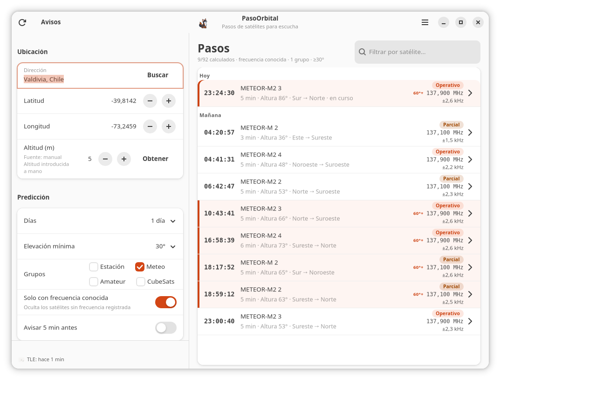
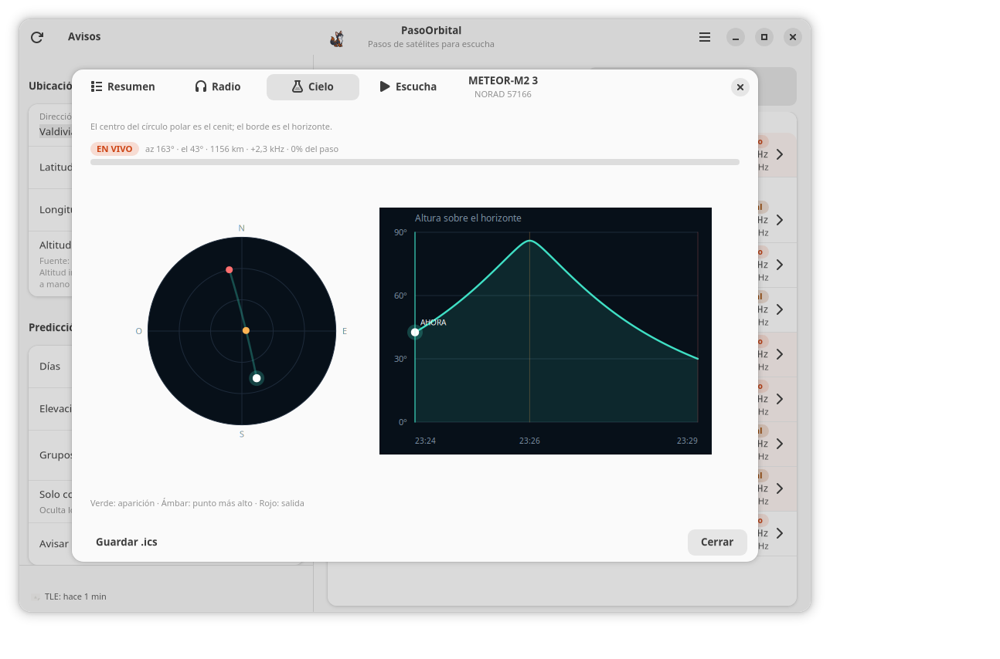

# PasoOrbital Desktop

[](https://github.com/asterion/pasoorbital/actions/workflows/tests.yml)
[](LICENSE)
[](https://www.python.org/)

Aplicación de escritorio para GNOME que calcula **qué satélites pasan por tu
ubicación**, con hora, elevación, azimut, duración, frecuencia de escucha y
efecto Doppler. Está pensada para radioaficionados y para quienes reciben
satélites meteorológicos.

Es software libre bajo licencia MIT. La aplicación es local: no tiene cuentas,
telemetría ni servidor propio.



## Funciones

- Predicción para 1, 2, 3 o 7 días, con elevación mínima configurable.
- Catálogo de CelesTrak por grupos: estaciones, meteorológicos, radioaficionados
  y CubeSats.
- Caché de TLE en disco y refresco manual.
- Lista agrupada por **Hoy**, **Mañana** y fecha.
- Hora destacada, duración, altura, dirección, frecuencia y Doppler.
- Pasos de **60° o más** resaltados como más favorables.
- Estado operativo **SATCAT** de CelesTrak, con fuente, fecha y advertencia.
- Detalle con pestañas **Resumen**, **Radio**, **Cielo** y **Escucha**.
- **Cielo en vivo** con marcador, estela y progreso del paso.
- **Modo escucha** con cuenta atrás, horas local/UTC, posición actual, Doppler,
  checklist y comando de SatDump.
- **Aviso de escritorio 5 minutos antes**, mientras la aplicación está abierta.
- **Astro**, la mascota, en la cabecera y en el estado vacío.
- Paquetes **`.deb`** y **`.rpm`**.



[Ver el detalle con pestañas](docs/desktop-detalle.png).

## Requisitos

- Linux con GNOME, GTK 4 y libadwaita 1.6 o superior.
- Python 3.10 o superior.
- `python3-gi`, `gir1.2-gtk-4.0`, `gir1.2-gdkpixbuf-2.0`, `gir1.2-adw-1`,
  `python3-numpy` y `python3-sgp4`.
- En Fedora: `python3-gobject`, `gtk4`, `libadwaita`, `gdk-pixbuf2`,
  `python3-numpy` y `python3-sgp4`.

## Instalar

Descarga el paquete desde la última release:

- [Última release](https://github.com/asterion/pasoorbital/releases/latest)
- [`.deb` para Debian/Ubuntu](https://github.com/asterion/pasoorbital/releases/download/v1.10.0/pasoorbital_1.10.0-1_all.deb)
- [`.rpm` para Fedora](https://github.com/asterion/pasoorbital/releases/latest)

```bash
# Debian / Ubuntu
sudo apt install ./pasoorbital_1.10.0-1_all.deb
pasoorbital-gui

# Fedora
sudo rpm -ivh pasoorbital-1.10.0-1.noarch.rpm
pasoorbital-gui
```

El RPM es `noarch` y guarda los módulos en `/usr/lib/pasoorbital`, fuera de
`site-packages`: funciona con Fedora 41-44 y con cualquier Python 3.10 o
superior, sin recompilarlo para cada versión de Python.

<details>
<summary>Aviso al instalar un <code>.deb</code> local</summary>

Si aparece «La descarga se realiza sin aislamiento como root…», es porque el
archivo está dentro de una carpeta privada y el usuario `_apt` no puede leerlo.
No es un error. Para evitarlo:

```bash
cp pasoorbital_1.10.0-1_all.deb /tmp/
sudo apt install /tmp/pasoorbital_1.10.0-1_all.deb
```
</details>

## Ejecutar desde el código

Desde la raíz del repositorio, sin crear ni instalar un paquete:

```bash
cd satelites
PYTHONPATH=.:desktop python3 -m pasoorbital_gui.app
```

O usa el lanzador:

```bash
./run.sh
```

El Python del sistema debe tener `gi`, `sgp4` y `numpy`. Si tu distribución no
incluye `sgp4`, instala `python3-sgp4`.

## Controles

1. Escribe una dirección y pulsa **Buscar**, o introduce latitud y longitud.
2. Elige días, elevación mínima y grupos.
3. Pulsa **Calcular pasos**.
4. Pulsa una fila para abrir el detalle.
5. Activa **Avisos** para recibir el aviso de 5 minutos.
6. En el detalle, usa **Escucha** para preparar la recepción.

Los cambios de días, elevación y grupos se recalculan automáticamente. El botón
**Calcular pasos** sirve para recalcular de inmediato.

## Estado de los satélites

El estado **SATCAT** procede de CelesTrak y se cachea 24 horas. Se muestra en la
lista y en el detalle con su fuente y fecha.

> El estado del catálogo no garantiza que el transmisor esté encendido. Un
> satélite puede figurar como operativo y no transmitir, o al contrario.

## Datos y caché

- Configuración: `~/.config/pasoorbital/config.json`.
- TLE, estado SATCAT y caché de direcciones/altitudes:
  `~/.cache/pasoorbital/`.

La aplicación consulta CelesTrak para los TLE, Nominatim/Photon para direcciones
y Open-Meteo para la altitud del terreno. No envía telemetría.

## Construir los paquetes

```bash
cd desktop
./build_deb.sh     # Debian/Ubuntu
./build_rpm.sh     # Fedora; requiere rpmbuild
```

Los paquetes quedan en `desktop/dist/`. El workflow `packages` los construye y
los adjunta a la release cuando se publica un tag `v*`.

## Pruebas

```bash
python3 -m unittest discover -s tests -v
```

Las pruebas del motor no necesitan red. La interfaz se puede probar manualmente
con el comando de ejecución anterior.

## Estructura

```text
pasoorbital/
├── pasoorbital/          motor interno: TLE, SGP4, frecuencias, estado y geo
├── desktop/              aplicación GTK4, recursos y empaquetado
│   ├── pasoorbital_gui/
│   ├── build_deb.sh
│   ├── build_rpm.sh
│   └── pasoorbital.spec
├── tests/                pruebas unitarias
├── docs/                 capturas y recursos de Astro
├── .github/              CI y plantillas
├── run.sh                lanzador de desarrollo
├── pyproject.toml
├── requirements.txt
└── README.md
```

## Precisión y límites

- SGP4 con TLE de CelesTrak; con TLE recientes el error típico es bajo para
  apuntar antenas.
- No se modela refracción atmosférica.
- Los TLE caducan; la edad se muestra en la interfaz.
- Las frecuencias y el estado de los satélites pueden cambiar.
- Las notificaciones solo funcionan mientras la aplicación está abierta.

## Autores

- **Marcos Matamala Fernandez** — idea, producto, requisitos, pruebas y
  mantenimiento.
- **DeepSeek Harness (modelo deepseek-flash)** — implementación, documentación,
  empaquetado y revisión, en colaboración con Marcos.

La titularidad legal del copyright corresponde a Marcos Matamala Fernandez.
Detalles en [AUTHORS.md](AUTHORS.md).

## Créditos

- TLE y estado SATCAT: [CelesTrak](https://celestrak.org/).
- Propagación: [python-sgp4](https://github.com/brandon-rhodes/python-sgp4).
- Direcciones: OpenStreetMap vía Nominatim y Photon.
- Altitud del terreno: [Open-Meteo](https://open-meteo.com/).
- Frecuencias: información pública de AMSAT, IARU y las misiones.

## Licencia

MIT © 2026 Marcos Matamala Fernandez. Consulta [LICENSE](LICENSE) y
[AUTHORS.md](AUTHORS.md).

Documentación de desarrollo: [DESARROLLO.md](DESARROLLO.md).
