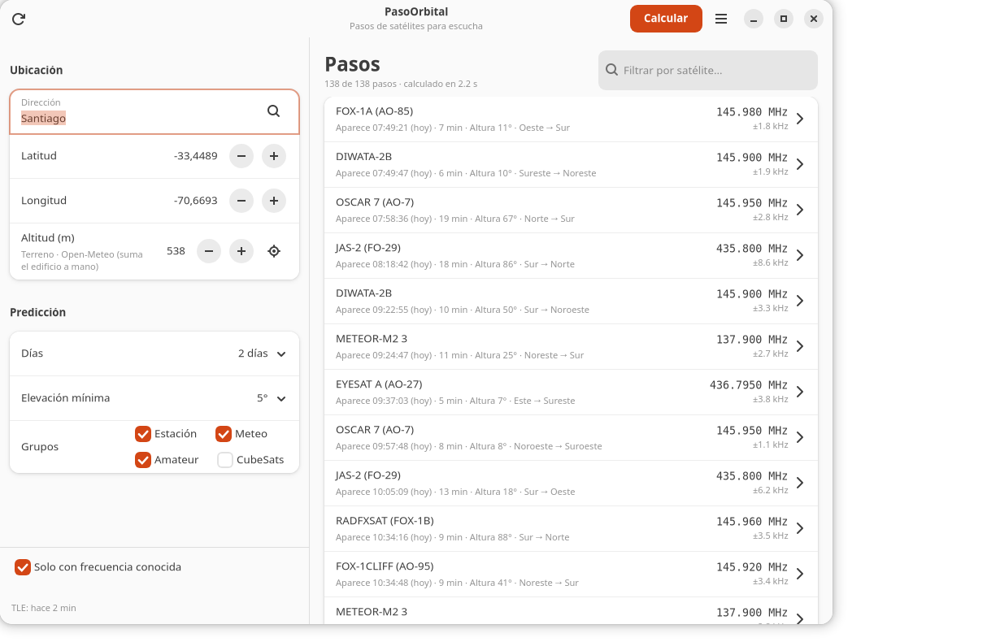
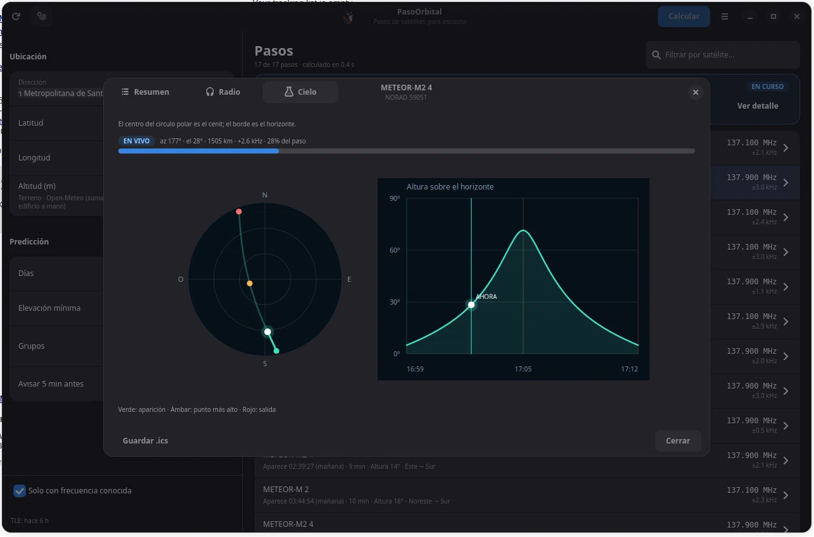

# PasoOrbital para GNOME





Aplicación de escritorio en **GTK4 + libadwaita** que reutiliza el motor de
PasoOrbital (`sgp4`, TLE de CelesTrak, frecuencias y geocodificación) sin depender
del navegador. Resalta los pasos que aparecen en los próximos 5 minutos, avisa
con una notificación del escritorio que abre el detalle del paso. La pantalla
principal destaca el próximo paso, muestra a **Astro** en la cabecera y el
detalle usa pestañas **Resumen**, **Radio** y **Cielo**, sin scroll. Los comandos
LRPT están ajustados a SatDump 1.2.2. La pestaña **Cielo** muestra en vivo el
marcador del satélite, su estela y el progreso del paso.

Los filtros de la barra lateral son reactivos: **Solo con frecuencia conocida**
se aplica al instante; cambiar **Días**, **Elevación mínima** o los **Grupos**
actualiza la lista y recalcula en segundo plano automáticamente.

## Requisitos

- Ubuntu 24.10 o superior / Debian 13 o superior (libadwaita 1.6+).
- `python3-gi`, `gir1.2-gtk-4.0`, `gir1.2-gdkpixbuf-2.0`, `gir1.2-adw-1`,
  `python3-numpy`, `python3-sgp4` (este último está en el repositorio `universe`
  de Ubuntu).
- Para el RPM: `rpmbuild` (`rpm-build` en Fedora).
- En Fedora: `python3-gobject`, `gtk4`, `libadwaita` (1.6+), `gdk-pixbuf2`,
  `python3-numpy` y `python3-sgp4`.
- Para construir el `.deb`: `dpkg-deb` (paquete `dpkg-dev`).

## Construir el paquete

```bash
cd desktop
./build_deb.sh
```

El paquete queda en `desktop/dist/pasoorbital_1.9.1-1_all.deb`.

## Construir e instalar el RPM

Necesitas `rpmbuild` (paquete `rpm-build` en Fedora). El RPM es un archivo local,
sin repositorio ni `dnf`, para Fedora 41 o superior. Los módulos se instalan en
`/usr/lib/pasoorbital`, así que el mismo RPM funciona con Python 3.10-3.14 y no
hay que reconstruirlo al actualizar Fedora.

```bash
cd desktop
./build_rpm.sh
sudo rpm -ivh dist/pasoorbital-1.9.1-1.noarch.rpm
```

Para actualizar:

```bash
sudo rpm -Uvh dist/pasoorbital-1.9.1-1.noarch.rpm
```

## Instalar el .deb

```bash
sudo apt install ./desktop/dist/pasoorbital_1.9.1-1_all.deb
```

> **Aviso de apt al instalar un `.deb` local:** si aparece
> «La descarga se realiza sin aislamiento como root…», es porque el archivo
> está dentro de una carpeta privada (por ejemplo, `/home/tu-usuario` con
> permisos 750) y el usuario `_apt` no puede leerlo. No es un error: el paquete
> se instala igualmente. Para evitarlo, copia el `.deb` a `/tmp` e instálalo
> desde allí:
>
> ```bash
> cp dist/pasoorbital_1.9.1-1_all.deb /tmp/
> sudo apt install /tmp/pasoorbital_1.9.1-1_all.deb
> ```


Si `python3-sgp4` no está disponible, habilita `universe`:

```bash
sudo add-apt-repository universe
sudo apt update
```

Después, abre **PasoOrbital** desde el menú de aplicaciones o ejecuta:

```bash
pasoorbital-gui
```

## Ejecutar desde el código fuente

Con un entorno que tenga `sgp4` y acceso a `gi`:

```bash
python3 -m venv --system-site-packages .venv-gui
.venv-gui/bin/pip install sgp4
PYTHONPATH=.:desktop .venv-gui/bin/python -m pasoorbital_gui.app
```

## Dónde guarda los datos

- Configuración: `~/.config/pasoorbital/config.json`.
- TLE y caché de direcciones: `~/.cache/pasoorbital/`.
- Frecuencias propias: `~/.config/pasoorbital/frequencies.json` (mismo formato que
  el descrito en el README principal).

## Notas

- Al buscar una dirección, la altitud del terreno se consulta en Open-Meteo
  (DEM Copernicus). Si estás en un piso alto, suma la altura del edificio a mano.

- La primera ejecución descarga los TLE de CelesTrak; después los cachea 6 h.
- La geocodificación usa Nominatim con caché de 30 días.
- Las predicciones son orientativas; no las uses para navegación crítica.
- La metainformación apunta al repositorio del proyecto; cambia la URL si publicas
  en otra cuenta.
